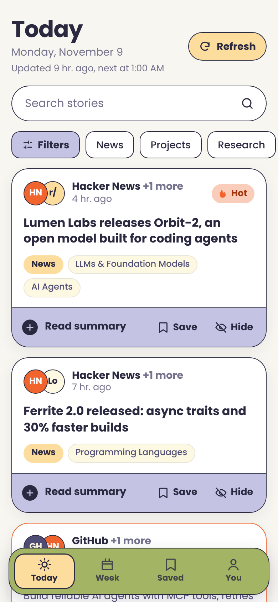
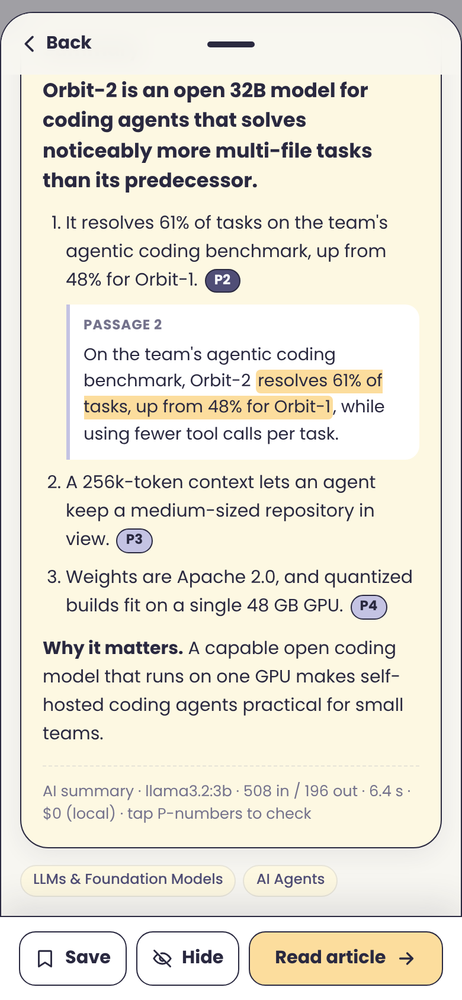
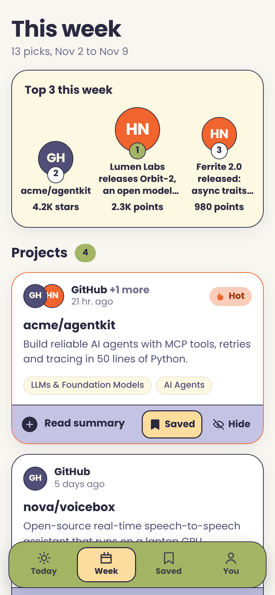

# OnYourTips

**A self-hosted morning briefing on AI and software: collected overnight, ranked, and
summarized by a local model, with every claim linked to the passage it came from.**

[](https://github.com/sanjana-302/onYourTips/actions/workflows/backend.yml)
[](LICENSE)


<p align="center">
  
  
  
</p>

Every night at 1 AM, OnYourTips:
1. **Collects** the day's best stories from about 20 sources: Hacker News, GitHub, arXiv,
   Hugging Face papers, Reddit, dev.to and lab blogs.
2. **Ranks** them deterministically by engagement across sources.
3. **Extracts** the full text and splits it into numbered passages.
4. **Summarizes** every story with a local LLM, before 08:30.

Each summary point cites the passages it's based on, and quotes them, so you can check it with
one tap. Every model call is recorded with its tokens, time and cost.

It's also a worked example of building an LLM feature properly: structured output, a cost
ledger, map-reduce for long inputs, deterministic checks, and **evals** (a golden set, human
labels, LLM-as-judge with Cohen's kappa, and model comparison). Every decision is written up
in [the docs](#documentation).

## Features

- **Daily pipeline** (`oyt nightly`), in this order:
  1. ingest the last 24 hours
  2. extract full text
  3. retry temporary failures
  4. re-tag topics
  5. summarize until a morning deadline
  6. raise alerts

  It survives network outages, failing sources and pages that never load.
- **Deterministic core:**
  - URL canonicalization and dedupe across sources
  - keyword topic tagging
  - engagement ranking
  - a weekly digest with per-type quotas and topic caps
- **Summaries with citations:**
  - `{tldr, key_points[{text, citations, quote}], why_it_matters}`, validated with pydantic
  - long articles summarized with map-reduce
  - invalid citations repaired; quotes checked against the source
- **Cost visibility:**
  - every call in an `llm_calls` ledger, with real tokens, latency and cost
  - exact token counts before each call, using the model's own tokenizer
  - estimated vs real cost for every summary
- **Evals:**
  - deterministic checks on every summary
  - a stratified golden set and claim-level human labels
  - an LLM judge, with its agreement measured
  - a model comparison report
- **Mobile web app** (React + TypeScript). Add it to your phone's home screen, tap citation
  chips to read the source passage, and save or hide stories. What you save and hide shapes
  an interest profile.
- **Local-first:** SQLite, Ollama, no accounts, no API keys required.

## How it works

```
sources.yaml ─► connectors ─► normalize · dedupe · tag · rank ─► articles (SQLite)
                                                                    │
   01:00 oyt nightly ─► extract full text ─► numbered passages ─────┤
                                                                    ▼
             plan (tokens, cost) ─► summarize ─► checks ─► summaries ─► FastAPI ─► app
                  (fits? one call : map-reduce)     (repair, gate, metrics)
                                       │
                                       └─► llm_calls ledger (every attempt, real tokens and cost)
```

One Python package with clear layers: `core` · `ingestion` · `ranking` · `storage` ·
`enrichment` · `llm` · `services` · `api`/`cli`. The CLI and the API are thin wrappers over
`services`. See [architecture](docs/architecture.md).

## Quick start

Requires [uv](https://docs.astral.sh/uv/), Python ≥ 3.10 and Node ≥ 20. For AI summaries you
also need [Ollama](https://ollama.com).

```bash
git clone https://github.com/sanjana-302/onYourTips.git && cd onYourTips

cd backend && uv sync                              # backend dependencies
uv run oyt ingest                                  # first batch of stories (~1 min)
uv run oyt feed                                    # what's new, in the terminal

cd ../frontend && npm install && npm run build     # build the web app
cd ../backend && uv run oyt serve                  # prints: On your phone: http://192.168.x.x:8000
```

Open the printed address on a phone on the same Wi-Fi. On iPhone, choose Share → **Add to Home
Screen**; on Android, choose **Install app**.

**AI summaries:**

```bash
ollama pull llama3.2:3b                 # default model, about 2 GB
uv run oyt llm status                   # is Ollama reachable?
uv run oyt summarize <article-id>       # one story; --plan shows tokens and cost without calling
```

**Daily refresh at 1 AM:** run `./scripts/install_schedule.sh` (macOS launchd). On Linux, a cron
line does the same: `0 1 * * * cd /path/to/backend && uv run oyt nightly`.

<details>
<summary><b>CLI cheat sheet</b></summary>

```bash
# reading
uv run oyt feed                        # today, ranked
uv run oyt digest                      # best of the week
uv run oyt open 3f9a1c2e               # open in the browser (ids accept a prefix)
uv run oyt save 3f9a1c2e -m "weekend idea"
uv run oyt dismiss 77b0e4d1
uv run oyt interests                   # topic weights from what you save and hide

# pipeline
uv run oyt nightly --trigger manual    # full refresh now (--no-summaries to skip the LLM)
uv run oyt alerts                      # failing sources, pages given up on, model unavailable
uv run oyt extract --show 3f9a1c2e     # a story's numbered passages

# AI, cost and evals
uv run oyt summaries                   # success rate, failure reasons, tokens, laptop time
uv run oyt costs --by purpose          # the ledger
uv run oyt tokens                      # summary size per article, articles over the context limit
uv run oyt llm compare -m llama3.2:3b -m qwen3.5:4b
uv run oyt eval golden                 # pick a golden set
uv run oyt eval label                  # judge claims yourself
uv run oyt eval judge -j qwen3.5:4b    # LLM-as-judge
uv run oyt eval agreement -j qwen3.5:4b
uv run oyt eval compare -m llama3.2:3b -m qwen3.5:4b -j granite4.2:3b
```
</details>

## Configuration

| What | Where |
|---|---|
| Sources (add an RSS feed in 3 lines) | `backend/config/sources.yaml` |
| Topics and their keywords | `backend/config/taxonomy.yaml` |
| Model prices (for cost projections) | `backend/config/pricing.yaml` |
| Tokenizer per model | `backend/config/tokenizers.yaml` |
| Settings (model, schedule, deadline, limits) | `OYT_*` environment variables or `backend/.env`; see [`.env.example`](backend/.env.example) |

## Documentation

- [Architecture](docs/architecture.md): pipeline, data model, ranking, digest, AI layer
- [Data dictionary](docs/data-dictionary.md): every table and column, with handy SQL
- [Evals field guide](docs/evals-field-guide.md): eval vocabulary, applied to this app's summaries
- [Architecture decision records](docs/adr/README.md): why things are the way they are
  - [0001](docs/adr/0001-repo-structure-and-storage.md): monorepo, SQLite, migrations
  - [0002](docs/adr/0002-summaries-and-citations.md): summaries with passage citations
  - [0003](docs/adr/0003-llm-cost-ledger.md): LLM gateway and cost ledger
  - [0004](docs/adr/0004-local-models-first.md): local models first
  - [0005](docs/adr/0005-daily-refresh-pipeline.md): daily refresh, retries, alerts
  - [0006](docs/adr/0006-summaries-every-story-and-evals.md): summaries for every story, map-reduce, evals

## Repository layout

```
backend/              Python package `onyourtips` (uv)
  src/onyourtips/     core · ingestion · ranking · storage · enrichment · llm · services · api · cli
  config/             sources · taxonomy · pricing · tokenizers
  tests/              unit · integration (offline: HTTP and the model are faked)
  scripts/            install_schedule.sh (macOS launchd)
frontend/             mobile web app: React 19 + Vite + TypeScript
docs/                 architecture · data dictionary · evals guide · ADRs
```

## Roadmap

- [x] Ingestion from ~20 sources, dedupe, tagging, ranking, weekly digest
- [x] FastAPI backend and mobile web app
- [x] LLM gateway, cost ledger, local models, model comparison
- [x] Full-text extraction and numbered passages, nightly
- [x] Summaries with citations for every story, map-reduce, evals
- [ ] Golden-set dev/test split; evals in CI on recorded outputs
- [ ] Embeddings: semantic search, story clustering, smarter tags
- [ ] Weekend-project recommendations from what you saved during the week

## Contributing

Issues and pull requests are welcome. See [CONTRIBUTING.md](CONTRIBUTING.md). It covers
running the tests (no network or model needed), adding a source, and changing a prompt safely.

## Security

OnYourTips has no login. Run `oyt serve` only on a network you trust. See
[SECURITY.md](SECURITY.md).

## License

[Apache License 2.0](LICENSE).
